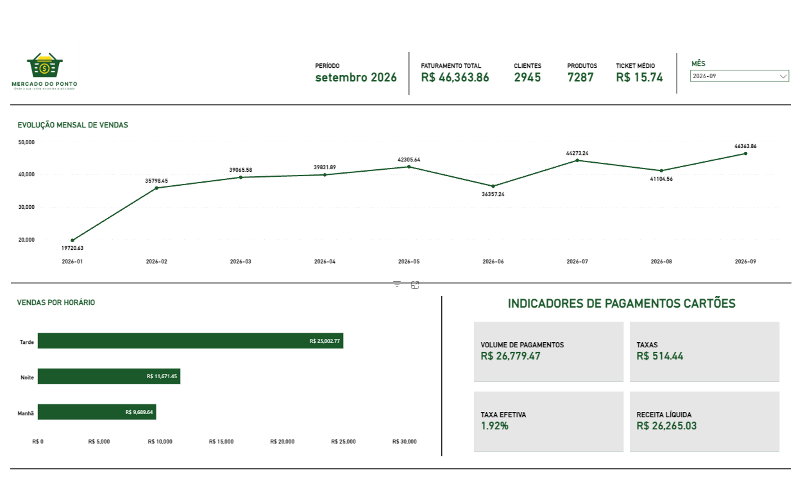
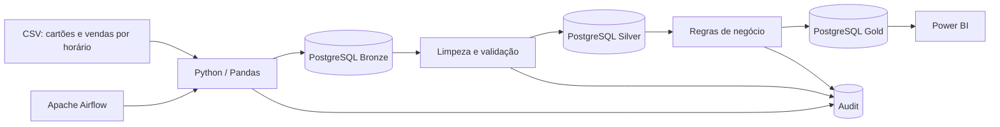
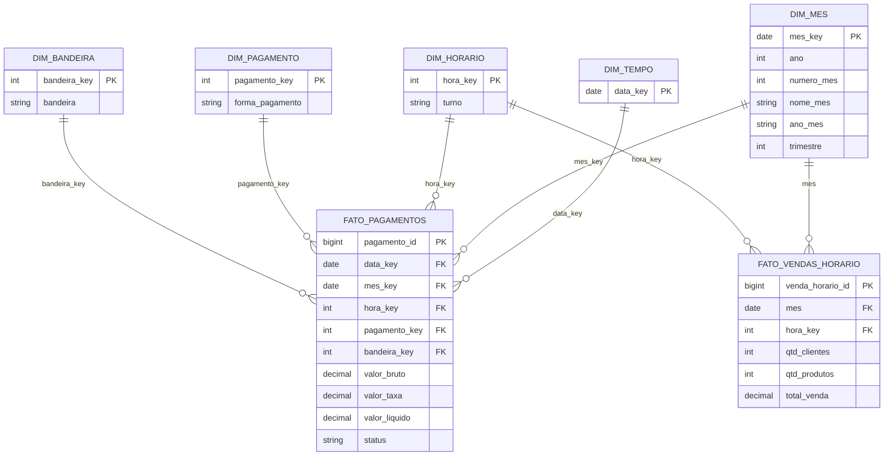

# Mercado do Ponto | Plataforma de Dados de Análise de Varejo

> Plataforma de Engenharia de Dados e Analytics para ingestão incremental, tratamento, modelagem dimensional, auditoria e análise de vendas de um mercado de bairro.

**[📊 Acessar dashboard interativo no Power BI](https://app.powerbi.com/view?r=eyJrIjoiNzg5NTliY2QtOGU1ZC00ZDNjLTk0OTQtZjRhZWExYWIyMWIyIiwidCI6IjY1OWNlMmI4LTA3MTQtNDE5OC04YzM4LWRjOWI2MGFhYmI1NyJ9)**



## Visão geral

O projeto transforma arquivos CSV de duas fontes, transações de cartões e vendas agregadas por horário, em dados organizados nas camadas **Bronze, Silver e Gold** do PostgreSQL. A solução usa Python e Pandas para processamento, Apache Airflow para orquestração, Docker Compose para infraestrutura local, Pytest para testes e Power BI para visualização.

O foco é demonstrar decisões de engenharia de dados aplicáveis a projetos reais: ingestão incremental, idempotência, correção de arquivos já recebidos, qualidade de dados, modelagem dimensional, rastreabilidade e separação entre indicadores de fontes com escopos diferentes. 

O conjunto utilizado na demonstração combina dados de origem e dados sintéticos, com o objetivo de preservar informações comerciais sensíveis. Os períodos sintéticos são identificados explicitamente abaixo.

## Indicadores do ambiente atual

Os valores abaixo correspondem ao período **janeiro a setembro de 2026**. 

| Indicador | Valor |
| --- | ---: |
| Faturamento agregado por horário | **R$ 344.821,09** |
| Clientes contabilizados na fonte horária | **22.421** |
| Produtos contabilizados na fonte horária | **56.890** |
| Ticket médio ponderado | **R$ 15,38** |
| Volume bruto de pagamentos registrados | **R$ 242.416,45** |
| Meses no modelo | **9** |
| Registros em `gold.fato_pagamentos` | **14.845** |
| Registros em `gold.fato_vendas_horario` | **119** |

**Atenção à interpretação:** faturamento e volume bruto de pagamentos vêm de **fontes diferentes**. Os CSVs de **vendas de cartões** representam transações de cartões, enquanto os CSVs de **vendas por horário** representam vendas agregadas em cartões e dinheiro. Por isso, os dois indicadores não devem ser tratados como equivalentes nem conciliados diretamente sem regras adicionais.


**Transparência dos dados:** os arquivos de vendas por horário de **abril a setembro de 2026 contêm dados sintéticos**, utilizados para demonstrar a evolução mensal e os recursos da plataforma. Esses dados não representam movimentações reais verificadas do estabelecimento. A utilização de dados simulados contribui para preservar informações comerciais da origem. 

## Arquitetura



| Camada | Responsabilidade |
| --- | --- |
| **Raw** | Arquivos CSV recebidos, organizados por fonte e período. |
| **Bronze** | Persistência próxima à origem, com identificação do arquivo/lote e proteção contra duplicação. |
| **Silver** | Tipagem, padronização, limpeza e consistência dos registros. |
| **Gold** | Tabelas fato, dimensões e views para consumo analítico. |
| **Audit** | Histórico de arquivos, execuções, eventos de reprocessamento e verificações de qualidade. |
| **Power BI** | Modelo semântico, medidas DAX, filtros e dashboards. |

## Fontes e periodicidade

A carga histórica inicial contempla **janeiro a março de 2026**, recebida em arquivos consolidados:

```text
data/raw/vendas_cartoes/vendas_cartoes_2026_01_2026_03.csv
data/raw/vendas_por_horario/vendas_por_horario_2026_01_2026_03.csv
```

De **abril a setembro de 2026**, os arquivos são mensais, por exemplo:

```text
data/raw/vendas_cartoes/vendas_cartoes_2026_04.csv
data/raw/vendas_por_horario/vendas_por_horario_2026_04.csv
```

O `batch_id` identifica a entrega, enquanto o mês analítico é derivado dos campos de data da fonte. Arquivos mensais devem conter somente registros do período correspondente. Arquivos acumulados exigem tratamento específico antes da ingestão.

## Modelo dimensional - Gold

O projeto introduz a dimensão mensal `gold.dim_mes`, permitindo que as duas tabelas fato compartilhem um filtro de mês no Power BI, apesar das granularidades distintas.



**Granularidades:** `fato_pagamentos` representa transações registradas dos cartões; `fato_vendas_horario` representa o total de vendas de cartões e dinheiro por mês e horário. Não é preciso unir diretamente as duas fatos, pois isso pode multiplicar valores. Usamos as dimensões compartilhadas para filtrar e comparar indicadores respeitando o escopo de cada fonte.

A migração da dimensão mensal está em `database/ddl/004_dim_mes_migration.sql` e é aplicada pelo fluxo de inicialização/migração do pipeline.

## Regras de negócio

| Indicador | Definição |
| --- | --- |
| **Faturamento** | `SUM(gold.fato_vendas_horario.total_venda)` |
| **Clientes** | `SUM(gold.fato_vendas_horario.qtd_clientes)` |
| **Produtos** | `SUM(gold.fato_vendas_horario.qtd_produtos)` |
| **Ticket médio** | `Faturamento / Clientes`, ponderado pelo total de clientes |
| **Volume bruto de pagamentos** | `SUM(gold.fato_pagamentos.valor_bruto)` |
| **Taxas** | `SUM(gold.fato_pagamentos.valor_taxa)` |
| **Receita líquida de pagamentos** | `SUM(gold.fato_pagamentos.valor_liquido)` |
| **Taxa efetiva** | `Taxas / Volume bruto de pagamentos` |

A validação financeira considera a relação `valor_bruto - valor_taxa ≈ valor_liquido`, respeitando diferenças de arredondamento. Transações PIX sem bandeira podem ser representadas pela categoria **Não se aplica**, em vez de serem classificadas como erro.

## Ingestão incremental e reprocessamento de correções

A plataforma controla o conteúdo dos arquivos RAW por **SHA-256**. A tabela `audit.processed_files` armazena o hash atual, e `audit.processed_file_events` preserva o histórico das ações.

| Situação | Comportamento |
| --- | --- |
| Arquivo novo | Processamento e evento `PROCESSED`. |
| Mesmo nome e mesmo hash | Arquivo ignorado, sem recarga desnecessária. |
| Mesmo nome e hash diferente | Reprocessamento controlado e evento `REPROCESSED`. |

No reprocessamento, o pipeline substitui os registros anteriores da fonte/período nas camadas correspondentes e reconstrói a Gold a partir do estado consistente da Silver. O objetivo é corrigir a informação **sem somar os dados novos aos antigos**.

### Caso validado: correção de abril de 2026

O arquivo `vendas_por_horario_2026_04.csv` foi substituído por uma versão sintética corrigida, mantendo as mesmas colunas e 13 horários.

| Indicador | Março/2026 | Abril/2026 corrigido |
| --- | ---: | ---: |
| Registros horários | 13 | 13 |
| Clientes | 2.536 | 2.525 |
| Produtos | 6.462 | 6.459 |
| Faturamento | R$ 39.065,58 | R$ 39.831,89 |

A consulta à auditoria retornou, para o arquivo de abril, um evento inicial `PROCESSED` e um evento posterior **`REPROCESSED` com 13 registros**. A consulta à `gold.fato_vendas_horario` confirmou **13 registros em abril**, com os totais corrigidos. Isso valida o cenário executado de substituição sem duplicação visível na Gold para esse período; não equivale a uma certificação de todos os cenários possíveis de recuperação ou concorrência.

Consulta de verificação:

```sql
SELECT
    mes,
    COUNT(*) AS registros,
    SUM(qtd_clientes) AS clientes,
    SUM(qtd_produtos) AS produtos,
    ROUND(SUM(total_venda), 2) AS faturamento
FROM gold.fato_vendas_horario
WHERE mes IN ('2026-03-01', '2026-04-01')
GROUP BY mes
ORDER BY mes;
```

Auditoria de arquivos:

```sql
SELECT
    source_file,
    action,
    rows_read
FROM audit.processed_file_events
WHERE source_file LIKE '%2026_04%'
ORDER BY source_file, action;
```

> **Preservação dos dados:** não use `docker compose down -v` para corrigir arquivos ou reiniciar serviços. A opção `-v` remove volumes persistentes, inclusive o banco local.

## Orquestração com Apache Airflow

O DAG principal no ambiente atual é **`mercado_analytics_monthly`**. As entregas mensais são acionadas manualmente após a disponibilização dos arquivos, evitando presumir uma data fixa de chegada.

```text
check_postgres
      |
      v
run_incremental_pipeline
```

O fluxo verifica a disponibilidade do PostgreSQL e executa a ingestão incremental. No ambiente Python, o comando equivalente é:

```bash
PYTHONPATH=src LOAD_TO_POSTGRES=true INCREMENTAL_LOAD=true python run_pipeline.py
```

A DAG foi executada com sucesso após a atualização, incluindo a aplicação da migração mensal. Uma execução sem alterações nos arquivos registrou que não havia novos RAW mensais a processar, com retorno `0`.

## Data Quality e observabilidade

O schema `audit` mantém o histórico operacional separado dos dados analíticos. Entre as verificações implementadas estão a presença de datasets e a consistência dos valores financeiros.

```sql
SELECT *
FROM audit.pipeline_runs
ORDER BY started_at DESC;

SELECT *
FROM audit.data_quality_results
ORDER BY checked_at DESC;

SELECT *
FROM audit.processed_file_events
ORDER BY processed_at DESC;
```

Validações realizadas no ambiente incluem contagens das tabelas Gold, integridade das chaves mensais de pagamentos e consistência entre a data da transação e seu mês de referência. O caso de correção do CSV de abril também foi verificado no banco e na auditoria.

## Power BI - estágio atual

**[Abrir dashboard publicado no Power BI](https://app.powerbi.com/view?r=eyJrIjoiNzg5NTliY2QtOGU1ZC00ZDNjLTk0OTQtZjRhZWExYWIyMWIyIiwidCI6IjY1OWNlMmI4LTA3MTQtNDE5OC04YzM4LWRjOWI2MGFhYmI1NyJ9)**

O link acima permite visualizar a versão publicada do relatório.

A página está desenvolvida com identidade visual verde e branca, logotipo, indicadores de faturamento, clientes, produtos e ticket médio, evolução mensal, vendas por turno e indicadores financeiros complementares.

O filtro `gold.dim_mes[ano_mes]` é compartilhado pelas duas fatos. O gráfico de evolução pode ser configurado para manter o histórico de janeiro a setembro mesmo quando um único mês estiver selecionado, por meio de **Editar interações**.

### Medidas DAX principais

```dax
Faturamento =
SUM('gold fato_vendas_horario'[total_venda])

Clientes =
SUM('gold fato_vendas_horario'[qtd_clientes])

Produtos =
SUM('gold fato_vendas_horario'[qtd_produtos])

Ticket Médio =
DIVIDE([Faturamento], [Clientes], 0)

Volume Pagamentos =
SUM('gold fato_pagamentos'[valor_bruto])

Receita Líquida =
SUM('gold fato_pagamentos'[valor_liquido])

Taxas =
SUM('gold fato_pagamentos'[valor_taxa])

Taxa Efetiva =
DIVIDE([Taxas], [Volume Pagamentos], 0)
```

> Os nomes acima refletem as tabelas importadas no Power BI do ambiente de desenvolvimento, incluindo o prefixo do schema no nome exibido.

### Conexão Power BI → PostgreSQL

No ambiente Docker local utilizado neste projeto:

| Parâmetro | Valor |
| --- | --- |
| Servidor | `127.0.0.1:5434` |
| Banco | `mercado_analytics` |
| Usuário | `postgres` (ambiente local) |
| Schema | `gold` |

Após uma carga ou correção bem-sucedida, clique em **Atualizar** no Power BI Desktop quando estiver usando modo Importação. Não confunda a porta do host (`5434`) com a porta interna do contêiner PostgreSQL (`5432`). Credenciais devem ser obtidas do seu `.env`, não publicadas no repositório.

## Como executar localmente

### Pré-requisitos

- Docker Desktop com Docker Compose;
- Git;
- Python e [`uv`](https://docs.astral.sh/uv/) para execução local opcional;
- Power BI Desktop para o dashboard (Windows).

### 1. Configurar variáveis

No PowerShell, na raiz do repositório:

```powershell
Copy-Item .env.example .env
```

Revise o `.env` de acordo com seu ambiente. **Nunca versione credenciais reais.**

### 2. Iniciar os serviços

```powershell
docker compose up -d --build
docker compose ps
```

No ambiente atual, o PostgreSQL é acessado pelo host em `127.0.0.1:5434`, e o Airflow em `http://localhost:8080`.

### 3. Executar a DAG

Abra o Airflow, localize `mercado_analytics_monthly` e dispare uma execução após disponibilizar os arquivos RAW. Confira o resultado de `check_postgres` e `run_incremental_pipeline`.

### 4. Executar manualmente (opcional)

Para rodar pelo serviço Docker configurado com profile manual:

```powershell
docker compose --profile manual run --rm pipeline
```

Ou, com as dependências Python instaladas e a conexão local configurada:

```powershell
uv sync --extra dev
$env:PYTHONPATH = "src"
$env:LOAD_TO_POSTGRES = "true"
$env:INCREMENTAL_LOAD = "true"
uv run python run_pipeline.py
```

### 5. Consultar o banco

```powershell
docker compose exec postgres psql -U postgres -d mercado_analytics
```

```sql
SELECT COUNT(*) FROM gold.dim_mes;
SELECT COUNT(*) FROM gold.fato_pagamentos;
SELECT COUNT(*) FROM gold.fato_vendas_horario;
```

### 6. Parar preservando o banco

```powershell
docker compose down
```

**Não adicione `-v`**, exceto quando quiser apagar intencionalmente os volumes e reconstruir o ambiente do zero.

## Testes e integração contínua

O repositório inclui testes com **Pytest** e workflow de **GitHub Actions** com lint **Ruff**, execução do pipeline e integração com PostgreSQL. O projeto também contempla cenários de idempotência. Para executar a suíte local:

```powershell
uv run pytest
```

---

## Estrutura do repositório

```text
.github/workflows/          CI e integração
airflow/dags/               DAGs do Airflow
data/raw/                   arquivos de origem
data/silver/                saídas tratadas
data/gold/                  saídas analíticas
database/ddl/               DDL e migrações (inclui 004_dim_mes_migration.sql)
database/views/             views analíticas
database/queries/           consultas SQL de negócio
docs/                       documentação e evidências
notebooks/                  análise exploratória
powerbi/                    arquivos do dashboard
src/mercado_analytics/      módulos do pipeline
tests/                      testes automatizados
Dockerfile                  imagem do pipeline
Dockerfile.airflow          imagem do Airflow
docker-compose.yml          infraestrutura local
run_pipeline.py             ponto de entrada
```

## Documentação complementar

- [Arquitetura e decisões técnicas](docs/architecture.md)
- [Dicionário de dados](docs/data_dictionary.md)
- [Regras de negócio](docs/business_rules.md)

## Stack

**Python · Pandas · SQL · PostgreSQL 17 · Psycopg · Apache Airflow · Docker Compose · Pytest · Ruff · GitHub Actions · Power BI · uv**

## O que este projeto demonstra

- Pipeline batch end-to-end e arquitetura Bronze/Silver/Gold.
- Modelagem dimensional com duas tabelas fato e dimensões compartilhadas.
- Tratamento de dados, regras de negócio e qualidade.
- Carga incremental com hash de conteúdo, idempotência e reprocessamento controlado.
- Auditoria operacional e rastreabilidade de arquivos.
- Orquestração com Airflow e infraestrutura reproduzível com Docker.
- Testes automatizados e integração contínua.
- Construção de indicadores no Power BI, com atenção à granularidade e ao escopo das fontes.

---

## Autor

**Rafael Porfirio**

Projeto desenvolvido para demonstrar conhecimentos práticos em **Engenharia de Dados, SQL, Python, PostgreSQL e Analytics**.
